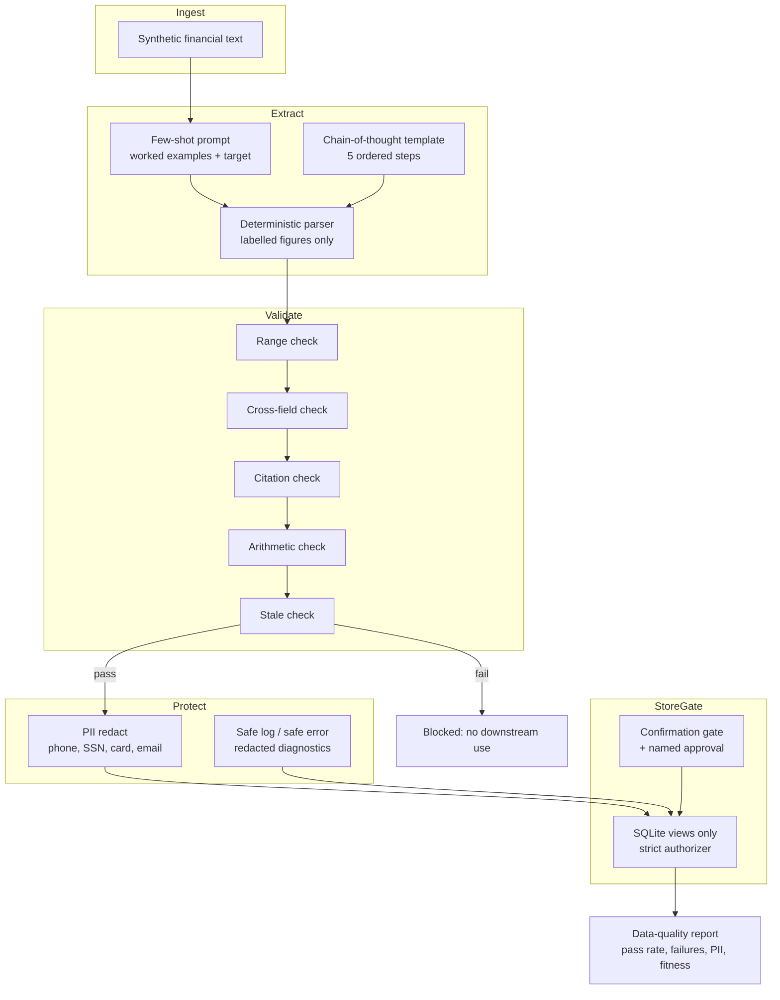

# Knowledge: architecture (Mermaid)

The same diagram in short form lives in `docs/architecture.md` and in
the README. The rule the diagram encodes: every stage can only narrow
what flows downstream.
